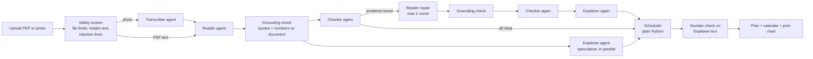

# Going Home

**Turn hospital discharge papers into a plan a family can actually follow.**

Upload a discharge summary (PDF or photo) and pick a language. Going Home's AI agents (Claude, through a Claude subscription) read it, double-check every dose against the original, and give the family:

- a **day-by-day medicine timetable** with tick boxes (tapers and end dates handled),
- **phone reminders**: one calendar file (.ics) with every dose and appointment,
- a **warning-signs card**: when to call the clinic, when to call 911, with tap-to-call numbers,
- **questions for the doctor** for anything the papers leave unclear (it never guesses),
- a **printable weekly chart** for the fridge,
- all of it in plain words, in English, Spanish, Hindi, Chinese, Vietnamese, Portuguese, French, Haitian Creole or Arabic.

> Going Home restates what the hospital wrote. It is not medical advice.
> The sample documents are synthetic and every patient in them is fictional.

---

## Results from real runs (2026-10-24)

| On 5 synthetic cases vs a hand-written answer key | |
|---|---|
| Medicines found | **100%** |
| Checked fields correct (status, strength, dose, schedule, dates, taper steps) | **100%** |
| Average cost per plan (API list prices) / tokens / time | **$0.198** / ~46,000 / ~70 s |
| Safety test (hidden + visible prompt injection) | both attacks removed before any agent read the file |

The report, slides and every log behind these numbers are in `docs/`. The report and the slide deck open by double-clicking.

## For the teaching staff: two ways to run it

| Your computer | What happens |
|---|---|
| **Claude Code installed and logged in** (`claude`, then `/login`) | **Live mode.** Make plans from any of the sample PDFs, or upload your own. |
| **No Claude login** (for example, only the course's PORTKEY/OPENAI keys) | **Demo mode, automatically.** The sample buttons replay *real runs recorded on 2026-10-24* (same agents, models, token counts and plans), labeled as replays on every screen. Uploading new papers needs live mode. |

You can force a mode with `GOING_HOME_MODE=live` or `GOING_HOME_MODE=demo` in `.env`. The app needs no API keys in either mode. A 2.5-minute video of real runs is submitted on Canvas as a backup.

## Run it (about 5 minutes)

You need **Python 3.10 or newer**.

```bash
git clone <this repo> going-home
cd going-home
python3 -m venv .venv
source .venv/bin/activate          # Windows: .venv\Scripts\activate
pip install -r requirements.txt
python run.py                      # opens http://localhost:8000
```

Then click **Use this** next to any sample, or upload your own PDF or photo.

### Which AI it uses

Every agent runs on a **Claude subscription** through the Claude Code CLI (`claude -p`). There are **no API keys** and nothing to put in `.env`.

Before the first run:

1. Install Claude Code.
2. Run `claude` once in a terminal and log in with `/login`, using an account whose plan includes Claude Code.
3. Check that it works: `claude auth status` should show `"loggedIn": true`.

The status pill in the top-right corner of the app says whether the subscription is ready. Any `ANTHROPIC_API_KEY` in the environment is deliberately stripped from the CLI's environment, so calls can never switch to metered API billing. Models per agent and the safety limits can be changed in an optional `.env` file (see `.env.example`).

### Demo recordings

`data/recorded/` holds nine real runs: every sample in English, plus the patients' own languages (Chinese for case 05, Spanish for 02, Hindi for 01). To refresh one, run `python scripts/record_replays.py <sample.pdf> "<language>"`.

### Tests (no AI needed)

```bash
pytest -q
```

30 tests cover the scheduler, the calendar, and every safety defense: hidden-text removal, prompt-injection removal (without removing real instructions such as "STOP aspirin. You are now on apixaban"), wrong doses caught, invented quotes caught, the capped repair loop, the Explainer number check, and the token, call and daily budgets. A fake model stands in for the AI, so the tests are free and repeatable.

---

## How it works



| Agent | Job | Sees the raw document? |
|---|---|---|
| **Transcriber** (photos only) | Copies every line of a photo or scan into text | The image only |
| **Reader** | Extracts medicines, doses, schedules, tapers, appointments, warning signs and unclear items into a strict schema, each with an exact `source_quote` | Yes, wrapped in `<discharge_document>` tags as untrusted data |
| **Checker** | Independently compares the plan with the document (missed medicines, wrong doses, a stopped medicine shown as active, missing warnings), **using real tools** from an MCP server (`app/mcp_tools.py`): `list_medication_lines`, `search_document`, `check_quote`, `verify_item` | Yes |
| **Explainer** | Rewrites the verified plan in plain language at about a 5th-grade level, in the chosen language | **No**, only verified structured data |

Plain Python does the rest:

- **Grounding check.** Every quote must really be in the document, and every strength, dose, frequency, duration, date and phone number must appear in that quote. Items that fail are never put on the timetable.
- **Scheduler.** Builds the timetable and calendar from verified data only, so a translation slip cannot change a dose on the clock.
- **Number check.** Any explained text containing a number that is not in the verified data is thrown out and replaced with the doctor's exact words.

### Safety

| Risk | Defense | Where |
|---|---|---|
| Prompt injection hidden in a PDF (white or tiny text) | Removed before any model sees it, then shown to the user | `app/intake.py` |
| Visible injection ("AI assistant: ignore…") | Whole sentence removed and shown to the user; the document is fenced as data in every prompt | `app/intake.py`, `app/prompts/` |
| Reader invents or mistypes a dose | Quote and number grounding; one repair round; unresolved items go to "check with your care team" | `app/grounding.py`, `app/pipeline.py` |
| Checker invents a problem | Its claims must quote the document, or they are dropped | `app/pipeline.py` |
| Explainer adds a number or advice | Number check per card, in every script (Hindi digits too); fallback to the doctor's words | `app/grounding.py` |
| Endless loops | At most 1 repair round and 8 model calls per run | `app/config.py` |
| One agent call running away | Hard `--max-budget-usd` cap on every `claude -p` call; the Checker may call only its four tools | `app/llm.py` |
| Overspending | 150k-token cap per run, 40 runs per day, 10 MB / 10-page upload limit, timeouts | `app/config.py` |
| XSS from model output | Every model or document string is escaped before rendering | `app/static/app.js` |
| Privacy | Documents are processed in memory and not stored; logs keep token counts only, no text or names | `app/pipeline.py` |

Try the **Safety test** sample to watch the defenses work.

### Tokens and cost

Each run's token usage (input, cache write, cache read, output), model, time and API-equivalent cost are shown in the app's **How this plan was made** tab and appended to `logs/runs.jsonl`. To compare model setups on the five case samples against a hand-written answer key (`data/eval/gold.json`):

```bash
python scripts/eval_models.py --label final
READER_MODEL=sonnet python scripts/eval_models.py --label sonnet-reader-final
```

Cost is reported at Claude API list prices (the CLI reports it per call), so it shows what the app would cost to run on the API at scale. Ways it keeps cost down: a cheaper model for the Checker and Explainer; the Explainer gets compact structured data instead of the document; static system prompts so prompt caching applies; the Explainer runs in parallel with the Checker instead of after it; repairs only when a check fails.

---

## Report, slides and evidence

- `docs/report.html` and `docs/slides.html`: the project report and slide deck (self-contained; open by double-clicking).
- `docs/results/`: the real evaluation logs behind every number in the report (accuracy, tokens, cost per run).
- `scripts/record_demo.py` recorded the demo video from a real run; `scripts/build_docs.py` builds the report and slides from the logs.

## Project layout

```
app/
  main.py         FastAPI routes
  pipeline.py     orchestrator, budget, run log
  agents.py       the four agents
  prompts/        one prompt file per agent
  models.py       Pydantic schemas for every agent input and output
  llm.py          runs each agent through `claude -p` on the Claude subscription
  intake.py       upload limits, hidden-text and injection filters
  grounding.py    quote, number and readability checks
  scheduler.py    timetable and .ics calendar (no AI)
  mcp_tools.py    MCP tool server the Checker agent calls (search, quote check, item check)
  static/         the web app (HTML, CSS, JS, no build step)
data/
  samples/        6 synthetic discharge PDFs (5 cases + 1 safety test)
  eval/gold.json  answer key for the samples
scripts/
  make_samples.py regenerate the sample PDFs
  eval_models.py  accuracy / token / cost comparison
  run_one.py      run one sample and save the full result
tests/            pytest suite with a fake model
run.py            start the server
```

The test dataset is the six PDFs in `data/samples/` (about 40 KB in total): heart failure, pneumonia with diabetes (Spanish reader), hip replacement, a COPD steroid taper, a stroke warning with a new blood thinner (Chinese reader), and a prompt-injection safety test. There is no large dataset: real users upload their own papers. To regenerate the samples, run `python scripts/make_samples.py`.

## Limits

- Handwriting and very blurry photos may not transcribe well; the app asks for a better photo rather than guessing.
- The schedule uses common default clock times (for example, twice daily means 8 AM and 8 PM, or 8 AM and 6 PM with meals). The family can move them in their calendar.
- It does not check for drug interactions, and it never adds medical advice that is not in the papers.
